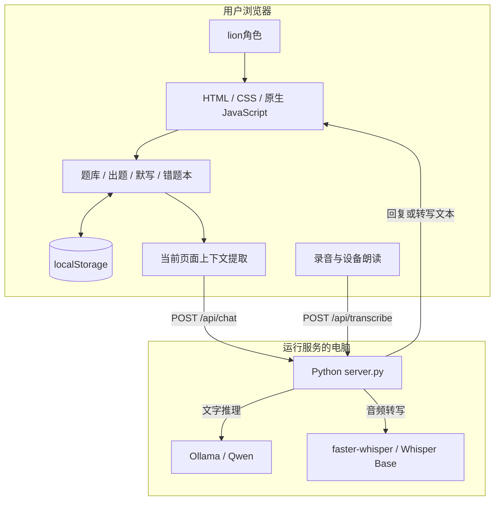
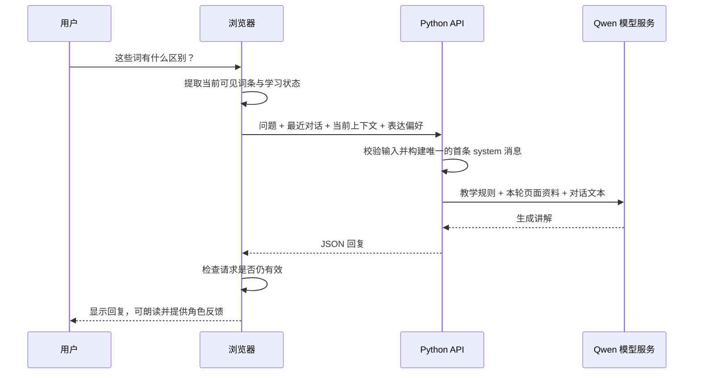
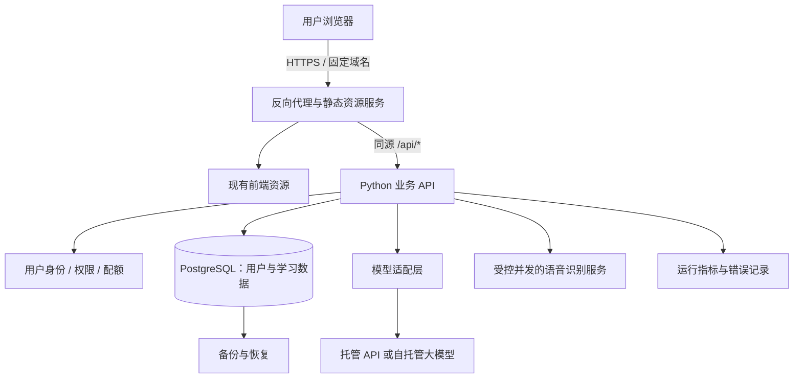

# DeskTalk 技术细节与产品化方案

> 用途：技术讲解、PPT 内容提炼及后续服务器产品化讨论。  
> 编写日期：2026-11-05。  
> 依据：当前工作目录中的实际代码与配置，包含尚未提交的本地实现。  
> 状态约定：**已实现**表示代码中已有对应逻辑；**规划建议**表示后续可采用的方案，不代表已经开发、部署或通过线上验证。

## 1. 一页 PPT 可直接使用的内容

### 标题

**DeskTalk：融合页面上下文与 AI 陪练的英语词汇学习平台**

### 一句话介绍

通过“词汇训练 → 即时反馈 → 错题积累 → AI 讲解”，将独立背词工具扩展为具有语音交互和角色陪伴的学习平台。

### 页面主体：三个模块

| 学习功能 | AI 技术 | 产品化方向 |
| --- | --- | --- |
| 普通、简单、雅思三套词库 | 从当前页面提取题目和可见词条 | 固定域名与 HTTPS 服务 |
| 双向选择题、混合训练、默写 | Qwen 结合当前上下文讲解 | 用户账号与跨设备同步 |
| 分类背词、错题本、词库导入导出 | Whisper 语音输入、浏览器朗读 | AI 配额、监控与持续运维 |
| 学习统计与本地进度保存 | lion角色与主动纠错提示 | 按访问规模扩展推理服务 |

### 页面底部：架构主线

**浏览器学习界面 → Python API → 大语言模型 / 语音识别**  
当前：学习数据保存在浏览器；未来：增加用户系统与服务端数据库。

### 约一分钟讲稿

“DeskTalk 的核心是把词汇训练与 AI 辅导连接起来。目前已经实现三套词库、选择题、默写和错题管理。技术上，基础学习在浏览器中完成；用户提问时，页面把当前题目、选项或可见词条整理成结构化资料，交给 Python 后端，再由 Qwen 生成讲解。因此用户可以直接问‘这几个词有什么区别’，无需重复复制题目。语音输入由 Whisper 转写，回复可使用设备声音朗读，lion负责提供交互入口和状态反馈。下一步是将服务迁移到服务器，补齐账号、云端同步和 AI 用量管理，形成持续在线的产品。”

> 排版建议：单页保留标题、三列表格、底部架构主线；讲稿放入演讲者备注。后续章节作为技术问答和附录材料。

## 2. 产品定位与当前边界

### 2.1 解决的问题

- **单词记忆零散**：提供按类别、近义关系和雅思 List 组织的学习内容。
- **答错后只知道答案**：自动记录错词，并可触发 AI 解释差异、记忆提示和简短例句。
- **向 AI 提问需要重复描述**：自动附带提问当时的页面资料。
- **文字交互门槛较高**：支持语音转文字、回复朗读和角色入口。

### 2.2 三种现有运行形态

| 形态 | 已有能力 | 运行条件与限制 |
| --- | --- | --- |
| 静态学习版 | 选择题、背词、默写、词库、统计、错题本等前端功能 | 可由 GitHub Pages 等静态托管提供；AI 入口显示本机功能说明 |
| 本机完整功能版 | 静态功能加文字 AI、页面上下文、语音与角色交互 | 运行 `server.py`；文字 AI 需要模型服务，录音转写需要语音依赖与模型 |
| 临时远程共享版 | 通过 HTTPS 和口令访问本机完整功能 | 依赖站长电脑、共享程序和模型持续运行；共享地址会随重启变化 |

静态学习版入口由 [README.md](README.md) 记录为 [DeskTalk 在线页面](https://ixoahzy.github.io/Luma-Words/)。本文未对该线上页面进行实际访问验证。

**当前还没有实现的产品能力**：独立用户账号、服务端学习数据库、跨设备同步、付费订阅，以及正式服务器部署与可用性保障。现有选择题属于随机出题，尚不能称为自适应学习或间隔重复算法；语音转写也不等于发音评分。

## 3. 当前技术架构：已实现



### 3.1 技术栈与职责

| 层次 | 当前技术 | 主要职责 |
| --- | --- | --- |
| 界面与学习逻辑 | HTML、CSS、原生 JavaScript | 页面交互、题库管理、判题、统计、默写 |
| 题库组织 | 内置 JavaScript 数据、雅思 List 适配模块 | 加载词条、保留来源顺序、按范围出题 |
| 浏览器存储 | `localStorage` | 保存词库修改、错题、统计、进度及偏好 |
| PDF 解析 | pdf.js，当前页面引用版本为 `3.11.174` | 在浏览器内提取 PDF 文本并识别词条 |
| 应用后端 | Python 标准库 `ThreadingHTTPServer` | 提供白名单静态文件、聊天 API、语音 API |
| 文字推理 | Ollama，默认模型标识 `qwen2.5:latest` | 根据用户问题与当前页面资料生成解释 |
| 语音识别 | `faster-whisper==1.2.1`、Whisper Base | 服务端将录音识别为中英文文本 |
| 回复朗读 | Web Speech API | 使用用户设备可用的本地声音播放回复 |
| 临时分享 | Cloudflare 通道、Python 共享网关 | HTTPS 入口、口令会话、请求限制 |

`qwen2.5:latest` 是配置中的模型标识，不能据此确定实际参数规模、量化方式或硬件需求。上线前需要记录最终使用的具体模型版本。

### 3.2 关键文件

| 文件 | 职责 |
| --- | --- |
| [index.html](index.html) | 主界面、普通及简单题库、训练流程、存储与页面上下文提取 |
| [ielts-word-data.js](ielts-word-data.js) | 雅思词条、List 和原书序号数据 |
| [ielts-library.js](ielts-library.js) | 雅思范围筛选、来源校验与词条格式转换 |
| [ai-chat.js](ai-chat.js) | 聊天、上下文刷新、请求取消、主动提示和个性设置 |
| [ai-voice.js](ai-voice.js) | 浏览器录音、转写上传、中英文朗读和声音设置 |
| [ai-pet.js](ai-pet.js) / [ai-pet.css](ai-pet.css) | lion的动画、拖拽、菜单、大小与状态反馈 |
| [server.py](server.py) | 本机静态服务、输入校验、模型消息组装与 API 转发 |
| [voice_backend.py](voice_backend.py) | 音频校验、内存解码、模型加载与语音转写 |
| [remote_gateway.py](remote_gateway.py) | 口令认证、临时会话、同源校验与限流 |
| [scripts/share_remote.py](scripts/share_remote.py) | 启动和关闭临时共享所需进程 |
| [.env.example](.env.example) | 模型服务地址、模型名、超时与本机端口配置示例 |

## 4. 学习引擎与词库：已实现

### 4.1 题库结构

| 词库 | 当前内置条目数量 | 组织方式 |
| --- | --- | --- |
| 普通模式 | 7,749 | 内置词条，另有分类学习数据 |
| 简单模式 | 2,819 | 中考核心词汇，独立于普通模式 |
| 雅思词汇真经 | 3,605 | 22 个 List，保留 List 内原书顺序 |

以上为当前内置数据规模，用户修改或导入后实际数量会变化。三套词库存在交叉词汇，不能将条目数量相加后宣称为去重总词量。

基础词条包含 `id`、`word`、`meaning`；雅思词条进一步保留 `ipa`、`listId`、`listName`、`order` 与 `source`。

### 4.2 四选一出题逻辑

1. 读取当前词库；雅思模式进一步按所选 List 过滤。
2. 确定“看词选意”或“看意选词”；混合模式从可用方向中随机选择。
3. 检查该方向是否至少存在四种不同的答案文本。
4. 随机抽取正确词条，尽量避免与上一题相同。
5. 打乱候选词条，挑选三个答案文本不重复的干扰项。
6. 将正确项与三个干扰项再次打乱，生成 A–D 选项。

判题和统计由前端完成，基础练习不需要调用 AI。当前干扰项并非由语义模型或难度模型生成。

雅思选择题还会校验词条是否与原始数据匹配；自定义导入或修改过来源字段的记录不会自动获得原书词条资格。产品化时应明确区分“官方词库练习”和“自定义词库练习”。

### 4.3 默写、错题与导入导出

- **默写**：按分类或 List 的既有顺序给出中文释义，用户输入英文；按学习模式和分类保存进度，可跳转或重新开始。
- **错题本**：答错自动加入，也支持手动收藏；保留错误次数和添加时间，三种学习模式共用当前浏览器的错题集合。
- **词库管理**：增删改查、批量操作、JSON 导入导出；PDF 导入先展示识别预览，再确认写入。
- **PDF 处理方式**：按页面文字坐标组合行，再使用规则提取英文与中文释义；当前没有扫描图片 OCR 流程。
- **错题导出**：支持选择错题后导出供 Word 打开的文件；不要据按钮名称推断为完整的原生 `.docx` 生成系统。

## 5. 核心技术：AI 如何知道用户正在学什么

### 5.1 使用结构化上下文，而非屏幕截图

网页通过 `window.DeskTalkTutor.getContext()` 读取应用状态与可见 DOM，整理当前学习资料。该功能不采集整块桌面，也不依赖视觉模型识别截图。

| 页面类型 `activity` | 提供的资料 | 回复规则 |
| --- | --- | --- |
| `quiz` | 当前题目、方向、四个词义配对、作答状态与所选答案 | 按 A–D 解释；未作答时不主动标出正确选项 |
| `dictation` | 中文提示、对应词条；提交后附输入与纠错资料 | 未提交时不主动透露完整拼写，明确索要时可回答 |
| `study` | 当前屏幕可见词条或用户明确选中的单词 | 按当前词条顺序解释，不沿用选择题格式 |
| `page` | 前台弹窗或页面的可见文字、相关词条 | 优先解释前台内容，避免误用背景题目 |
| `none` | 无有效学习资料 | 不编造当前页面内容 |

背词页和一般页面最多传递 24 条词条。前台弹窗优先于背景练习，用户手动提问时会再次读取页面快照。

### 5.2 请求与模型消息的组装



前端每次携带最近最多 8 条历史消息，再加本次用户消息。后端把**最后一条用户消息中的页面资料**放入首条 `system` 消息，历史消息则保留对话文本，防止旧题目继续充当当前页面事实。

当前做法属于“将页面上下文注入模型提示词”，不包含向量数据库或语义检索流程，不宜描述成已建成 RAG 知识库。

### 5.3 页面变化与过时回复处理

页面事件、滚动和 `MutationObserver` 负责触发上下文刷新。页面变化时会停止旧朗读，并按请求类型和页面变化情况取消过时请求；手动请求被取消时可将未完成问题放回输入框。

同时使用 `AbortController`、递增请求序号和回复前的上下文检查，降低旧回复覆盖新状态的概率。自动纠错提示保留来源题目，避免将上一题解释误当成下一题答案。

**边界**：浏览器取消等待，并不保证后端已发出的模型推理同时停止。服务器产品化时应进一步设计推理超时、任务取消与用量记录。

### 5.4 主动讲解与个性设置

- 答错或选中单词可触发简短提示；收起聊天面板时可在角色旁显示。
- 同一来源提示会进行去重，手动提问优先于自动提示。
- 支持温柔陪伴、活力伙伴、简洁老师与自定义提示词。
- 个性和主动提示开关保存在浏览器，对话仅保留在本页生命周期中。

未作答不主动泄露答案，属于模型提示规则；题目答案已存在前端数据和上下文中，不属于考试级防作弊机制。

## 6. 语音与角色交互：已实现

### 6.1 语音输入

**麦克风 → `MediaRecorder` → 音频请求 → Whisper 转写 → 输入框 → 用户确认发送。**

| 项目 | 当前实现 |
| --- | --- |
| 录音长度 | 浏览器 60 秒自动结束；后端解码后拒绝超过 61 秒的录音 |
| 上传大小 | 最大 8 MiB，即 `8 × 1024 × 1024` 字节 |
| 识别语言 | 自动检测、中文、英文 |
| 解码方式 | 内存中解码为 16 kHz 音频采样 |
| 推理配置 | Whisper Base；CPU、`int8`、4 个 CPU 线程；模型按需加载 |
| 并发限制 | 进程内一次只执行一个转写任务，忙碌时返回 429 |
| 原始音频处理 | 业务代码使用内存缓冲，不主动写入录音文件 |

转写完成后填入输入框，用户可以修改再发送。远程录音会经过网络传到运行后端的电脑；因此应表述为“服务端内存处理”，不能说远程语音始终留在访客设备。

浏览器麦克风接口要求安全上下文，正式公网服务应使用 HTTPS；`localhost` 可用于本地开发。参见 [MDN：getUserMedia](https://developer.mozilla.org/en-US/docs/Web/API/MediaDevices/getUserMedia)。

### 6.2 回复朗读

前端将回复按中英文与句子拆分，使用 `speechSynthesis` 朗读。声音选择列表筛选 `localService` 的中英文音色，并提供语速与停顿设置；实际声音和可用性取决于访客设备，当前没有服务端 TTS 或统一云端音色。

`localService` 用于区分设备本地声音和远程声音，参见 [MDN：SpeechSynthesisVoice.localService](https://developer.mozilla.org/en-US/docs/Web/API/SpeechSynthesisVoice/localService)。

### 6.3 lion网页角色

角色复用 WebP 动画图集，支持点击打开聊天、拖拽、大小设置、视线跟随、挥手、跳跃、收起和状态反馈。位置与偏好保存到浏览器；开启减弱动态效果时采用静态表现。

这是网页内的交互组件，作用是提供入口、提示和陪伴反馈；它本身不负责语言推理，也不具备系统桌面置顶等原生桌宠能力。

## 7. API 与请求约束：当前实现

### 7.1 `POST /api/chat`

请求类型为 `application/json`。示例中的词条只用于说明格式：

```json
{
  "messages": [
    {
      "role": "user",
      "content": "这两个词有什么区别？",
      "context": {
        "activity": "study",
        "scope": "viewport",
        "id": "study:example",
        "title": "背单词",
        "entries": [
          { "label": "1", "word": "affect", "meaning": "v. 影响" },
          { "label": "2", "word": "effect", "meaning": "n. 影响；效果" }
        ]
      }
    }
  ],
  "personality": "温柔耐心，简洁自然，中文讲解配英文例句。",
  "kind": "chat"
}
```

成功返回 `{"reply":"模型生成的讲解文本"}`，失败返回 `{"error":"面向用户的错误说明"}`。

| 约束 | 当前值 |
| --- | --- |
| 请求体 | 最大 131,072 字节，即 128 KiB |
| 消息格式 | 1–41 条，`user` 与 `assistant` 交替，首尾必须为 `user` |
| 消息长度 | 用户单条最多 4,000 字符；助手单条最多 12,000 字符；消息文本合计最多 32,000 字符 |
| 个性提示词 | 最多 2,000 字符 |
| 请求类型 | `chat` 或 `tip` |
| 输出预算 | `chat` 设置 `max_tokens=700`；`tip` 设置 `max_tokens=220` |
| 返回方式 | `stream=false`，一次返回完整回复 |
| 默认超时 | 模型请求 120 秒；浏览器聊天等待 130 秒 |

输出 token 预算由请求给出，实际是否完整遵守取决于模型服务；它也可能使大量可见词条的讲解提前截断。上述参数是当前代码限制，不是生产环境容量承诺。

### 7.2 `POST /api/transcribe`

- 请求体是原始音频二进制，不是 JSON 或文件表单。
- `Content-Type` 指定音频类型；后端允许 WebM、Ogg、MP4、WAV 等指定 MIME 类型。
- `X-Audio-Language` 为 `auto`、`zh` 或 `en`。
- 成功返回示例：`{"text":"请讲解这个单词", "language":"zh"}`。
- 原始音频与后续聊天是两个步骤；转写文本并不会自动成为已经发送的聊天消息。

常见错误状态包括输入无效、格式不支持、请求过大、转写忙碌、模型不可用和模型超时；界面将显示对应说明。

### 7.3 服务端配置

| 配置项 | 默认值或含义 |
| --- | --- |
| `QWEN_BASE_URL` | `http://localhost:11434/v1` |
| `QWEN_MODEL` | `qwen2.5:latest` |
| `QWEN_API_KEY` | 本机 Ollama 通常留空；配置后由后端发送认证头 |
| `QWEN_TIMEOUT` | `120` 秒 |
| `PORT` | `8000`；主服务仍绑定 `127.0.0.1` |

配置先读项目 `.env`，再由进程环境变量覆盖。模型请求在基础地址后追加 `/chat/completions`。密钥留在服务端；修改地址并不代表任何模型服务都已验证兼容。

## 8. 数据保存与隐私边界：当前实现

| 数据 | 当前保存位置 | 生命周期或限制 |
| --- | --- | --- |
| 三套词库及用户修改 | 浏览器 `localStorage` | 当前站点、当前浏览器中持久保存 |
| 训练设置与统计 | 浏览器 `localStorage` | 刷新可保留，不跨设备同步 |
| 错题本、默写进度 | 浏览器 `localStorage` | 随站点数据保存；清除站点数据会丢失 |
| AI 个性、语音和角色偏好 | 浏览器 `localStorage` | 同源页面可恢复 |
| 聊天记录 | 当前页面 JavaScript 内存 | 刷新后清空；请求中携带最近对话 |
| 录音 | 浏览器与后端内存 | 处理期间使用，不由当前业务代码保存为录音文件 |
| 临时共享会话 | 网关进程内存 | 默认 8 小时有效，重启失效 |

主要存储键包括 `lumaWords.library.v1`、`lumaWords.easyLibrary.v1`、`lumaWords.ieltsLibrary.v1`、`lumaWords.settings.v1`、`lumaWords.stats.v1`、`lumaWords.mistakes.v1` 和 `lumaWords.dictationProgress.v1`。

需要在讲解中说明三个边界：

1. **页面上下文会随问题发送给模型服务**，包括当前词条、题目与作答信息；当前实现不主动读取完整历史学习记录作为模型画像。
2. **本地保存不等于账号同步**。不同域名、浏览器和设备之间数据互不共享，临时分享域名变化也会影响存储访问。
3. **词库升级存在覆盖行为**。当前内置版本标识变化时会重新写入对应词库，普通词库更新还会重置统计。产品化应将系统词库版本与用户自定义内容分开存储，并提供迁移机制。

“不主动保存录音”描述的是当前业务代码；未来服务器、模型提供方及运维系统的数据处理策略，需要单独明确。

## 9. 临时远程共享：已实现及其限制

链路为：**访客 HTTPS → Cloudflare 通道 → `remote_gateway.py:8001` → `server.py:8000` → 模型服务。**

| 控制项 | 当前网关实现 |
| --- | --- |
| 登录 | 统一访问口令，使用随机会话 token |
| 会话 Cookie | `HttpOnly`、`Secure`、`SameSite=Strict`，有效期 8 小时 |
| API 频率 | 每会话每分钟最多 12 次聊天与转写请求，两类合计 |
| AI API 并发 | 网关最多同时转发 2 次聊天或转写请求 |
| 网关连接 | 最多 16 个同时处理的连接 |
| 转写并发 | 后端单进程转写锁进一步限制为 1 个 |
| 访问校验 | 校验 Host、Origin、登录态、请求大小和可访问路径 |
| 静态文件 | 使用明确白名单，不将整个项目目录公开 |

这些限制属于临时共享网关，不能推断本机 `server.py` 自带相同限流，也不能将“并发 2”理解为整个产品只能服务两个用户。并发处理请求数、登录会话数和实际在线用户数是不同指标。

网关会给页面注入远程运行标记，前端据此启用 AI。当前启动脚本固定使用本机 8000/8001 端口，与主服务可配置 `PORT` 的行为尚未统一。

该方式适合演示和小范围试用；电脑关机、网络中断或通道退出都会使完整功能不可用，不能作为正式持续在线产品的最终架构。

## 10. 正式服务器产品：规划建议，尚未实现

### 10.1 推荐的首版形态

建议采用**保留现有前端 + 单体 Python API + 数据库 + 独立推理服务**。先把持续在线、用户隔离和同步做完整，不在首版引入微服务或复杂编排。

| 方案 | 适用场景 | 取舍 |
| --- | --- | --- |
| 静态页面 + 托管模型 API + 业务后端 | 需要较快验证产品、初期 AI 用量不确定 | 自建推理运维较少；需评估请求成本、服务可用性和数据处理方式 |
| 业务后端 + 自托管模型 | 有合适硬件、模型维护能力和明确用量 | 模型运行可自行控制；需承担推理资源、扩容和更新工作 |
| 业务层统一模型接口，按条件选择上游 | 希望首版可用且后续可迁移 | 推荐保留这一边界；具体上游待压测与成本评估后确定 |

以上是文档建议，尚未替用户确定云厂商、服务器规格、模型供应商或付费方案。

### 10.2 目标架构



建议前端与 API 使用同一正式域名，减少当前相对接口路径的迁移工作。可采用 Nginx 等反向代理；业务 API 可迁移至 FastAPI 配合 Uvicorn，同时复用已有校验、消息组装和音频处理逻辑。

当前 `http.server` 适合作为本地原型基础。Python 官方明确不建议将其用于生产；正式部署应替换相应服务层。参见 [Python：http.server](https://docs.python.org/3/library/http.server.html)。

进程启动、故障重启、HTTPS、worker 数量和内存预算需要在部署时一起考虑，相关原则见 [FastAPI：部署概念](https://fastapi.tiangolo.com/deployment/concepts/)。增加 worker 时，每个进程可能各自加载语音模型，不能只按 HTTP 请求量扩进程。

### 10.3 当前代码迁移时必须处理的事项

| 当前实现 | 产品化需要完成的变化 |
| --- | --- |
| 非本机域名默认不启用 AI | 以明确的部署配置或运行能力接口决定 AI 是否可用 |
| 后端只接受本机 Host/Origin | 配置正式域名及代理信任边界，保留来源校验 |
| 统一分享口令 | 增加用户身份、会话管理、退出与账号级权限 |
| 学习数据保存在浏览器 | 增加用户隔离的学习 API 与数据库，同步保留本地缓存 |
| `.env` 与本机模型地址 | 使用服务器环境配置与密钥管理，确认模型网络可达 |
| 单进程限流、转写锁与内存会话 | 多实例时采用共享状态或统一调度，避免限制被逐实例放大 |
| 前端中止不保证推理停止 | 统一超时、任务生命周期和取消行为 |
| 本机脚本负责临时分享 | 使用正式进程托管、健康检查、固定域名与发布回滚流程 |

不能仅将监听地址改为 `0.0.0.0` 就视为部署完成；前端启用条件、后端域名校验、用户数据与模型资源都需要一起接通。

## 11. 用户数据与同步：规划建议

### 11.1 最小数据模型

| 数据表或集合 | 核心字段 | 用途 |
| --- | --- | --- |
| `users` | `id`、登录身份、创建时间 | 标识不同用户；具体登录方式后续确定 |
| `word_libraries` | `id`、类型、名称、版本 | 区分系统词库与个人词库 |
| `word_entries` | `id`、`library_id`、单词、释义、音标、List、序号 | 保存稳定词条与来源 |
| `user_words` | `user_id`、词条引用或个人内容、修改版本 | 保存个人新增、覆盖与删除状态 |
| `learning_events` | `id`、`user_id`、词条引用、模式、结果、时间 | 保存学习行为，避免只有累计数值 |
| `mistakes` | `user_id`、词条引用、错误次数、收藏状态 | 多设备共享错题集合 |
| `dictation_progress` | `user_id`、词库、分类或 List、进度 | 保存默写进度 |
| `user_preferences` | `user_id`、学习设置、AI 偏好、声音偏好 | 恢复个人体验 |
| `ai_usage` | `user_id`、请求类型、耗时、状态、用量 | 管理配额、成本与排错 |

学习数据查询必须由服务端当前登录身份限定，不能只依赖客户端传入 `user_id`。系统词库和个人修改分离，以免一次词库升级覆盖用户内容。

### 11.2 同步与旧数据迁移

1. 用户登录后，检测当前浏览器已有数据，并由用户选择导入账号或保留本地。
2. 为同步事件设置稳定 ID，服务端按用户和事件 ID 去重，避免重试使答题次数翻倍。
3. 设置与进度采用版本号或更新时间处理并发覆盖；跨设备冲突规则需在实现前确定。
4. 删除记录使用删除标记或明确的删除事件，防止其他设备将已删除数据重新上传。
5. 数据库成功落盘后才标记同步完成；失败时保留本地待同步状态。

若旧站点与正式站点域名不同，新站点不能直接读取旧域名的 `localStorage`。当前 JSON 导出主要面向词库，完整迁移错题、统计和设置还需要增加专门的导出导入能力。

聊天历史默认继续采用短期保存即可；若后续提供跨设备聊天历史，应另行确定保存范围、删除方式和用户开关。

## 12. 容量、成本与运行质量：规划建议

### 12.1 资源分开估算

- **前端静态资源**：主要消耗传输与缓存资源，可与推理资源分开扩容。
- **学习业务 API 与数据库**：关注写入频率、同步批量大小、用户隔离和备份。
- **AI 讲解**：关注输入输出 token、排队时间、推理吞吐和自动提示触发频率。
- **语音转写**：关注录音时长、解码开销、模型内存和并发任务数。

月度成本可拆为：**业务服务器 + 数据库及备份 + 模型调用或推理硬件 + 语音处理 + 带宽与运维**。当前没有真实生产流量与压测结果，不给出确定的服务器规格、承载人数或费用承诺。

### 12.2 首版控制策略

- 手动提问与主动提示分别计数，优先保证用户主动请求。
- 对每用户设置请求频率和用量配额；排队需要有长度上限与超时。
- 页面连续滚动时继续更新上下文，但不要每次变化都触发模型请求。
- 仅对不含个人信息的通用词义讲解评估缓存；缓存键包含词条版本、模型和讲解风格。
- 语音识别与文字聊天分别控制并发，模型繁忙时给出清晰提示，基础学习继续可用。

### 12.3 上线前应测量的指标

| 指标 | 验证目的 |
| --- | --- |
| 学习页面首屏与资源大小 | 确定内置大词库是否影响首次访问 |
| 聊天成功率及 P50/P95 总耗时 | 确定真实等待体验与容量边界 |
| 每请求输入输出用量、每用户 AI 用量 | 评估费用和配额 |
| 转写耗时与录音时长之比 | 评估语音识别容量 |
| 同步失败率、重复事件数、恢复结果 | 验证学习数据可靠性 |
| 模型与 API 重启后的恢复情况 | 验证故障处理能力 |

当前聊天为完整返回模式；只有引入流式返回后，“首 token 时间”才适合作为前端等待体验指标。本文没有将任何性能目标写成已经达到的结果。

## 13. 从原型到产品的实施顺序：规划建议

| 阶段 | 必须交付 | 验收方式 |
| --- | --- | --- |
| 1. 服务器完整功能试运行 | 固定域名、HTTPS、生产服务层、模型与语音服务、受控试用访问、进程恢复 | 本机电脑关闭后仍可访问；远程聊天、录音与基础训练可用 |
| 2. 用户与云端学习数据 | 登录、用户隔离、词库与错题同步、旧数据迁移 | 两台设备查看同一账号数据；不同账号互不可见；重试不重复计数 |
| 3. 小范围产品试用 | AI 配额、限流、运行监控、备份与恢复、错误提示 | 并发达到测定容量时有可控排队或拒绝；恢复演练成功 |
| 4. 面向实际用户发布 | 用量与费用评估、资料和素材授权确认、数据处理说明、发布回滚 | 完成真实浏览器和设备验收，发布后可观察、可回退 |

阶段 1 仍是受控试运行，不应被宣传为账号与云同步都齐备的公开产品。支付订阅、管理后台、推荐算法和更复杂学习计划属于后续需求，不作为当前已完成能力。

词库来源和角色素材在个人演示中的可用性，不自动等于商业产品中的分发授权；正式发布前应确认相应用途的授权范围。

## 14. 验证依据与讲解口径

### 14.1 本文编写时的核对范围

- 阅读了学习页面、雅思模块、聊天、语音、角色、主服务、共享网关及配置文件。
- 从当前源数据核对普通模式 7,749 条、简单模式 2,819 条；雅思数据结构为 22 个 List、3,605 条。
- 核对了聊天、语音接口参数、存储位置和临时共享限制。
- 参考官方文档确认了生产服务层与浏览器麦克风的部署要求。
- 本次仅交付技术文档，未修改应用代码，未部署服务器，也未执行完整应用测试或生产压测。

### 14.2 现有测试文件对应的验证范围

| 测试文件 | 对应内容 |
| --- | --- |
| [tests/ielts-data.test.mjs](tests/ielts-data.test.mjs) | 雅思数据、List 顺序与词库相关逻辑 |
| [tests/ai-context.test.mjs](tests/ai-context.test.mjs) | 页面上下文构建 |
| [tests/ai-chat-live.test.mjs](tests/ai-chat-live.test.mjs) | 实时页面变化与聊天状态 |
| [tests/ai-voice.test.mjs](tests/ai-voice.test.mjs) | 语音前端行为 |
| [tests/ai-pet.test.mjs](tests/ai-pet.test.mjs) | 网页角色交互 |
| [tests/test_chat.py](tests/test_chat.py) | 消息校验与模型上下文组装 |
| [tests/test_voice.py](tests/test_voice.py) | 音频输入校验 |
| [tests/test_remote_share.py](tests/test_remote_share.py) | 共享认证、转发与限制 |

上表表示现有测试的覆盖主题，不表示本次已经运行并通过，也不代替真实模型效果、设备兼容性或线上容量验证。

### 14.3 技术讲解时可直接采用的准确表述

| 可以这样说 | 需要避免的误解 |
| --- | --- |
| AI 会结合当前页面的结构化学习资料回答 | AI 在持续监控整个电脑屏幕 |
| 基础学习主要在浏览器执行和保存 | 已经具备用户云端数据库与跨设备同步 |
| 本机 Qwen 提供文字讲解 | 项目已经自行训练或微调了专用模型 |
| Whisper 提供中英文语音转写 | 已经实现口语发音评分或实时全双工通话 |
| 临时共享可让其他设备体验完整功能 | 临时通道已经具备正式持续在线服务保障 |
| 有明确的服务器产品化迁移路径 | 已经完成正式服务器部署与生产容量验证 |

